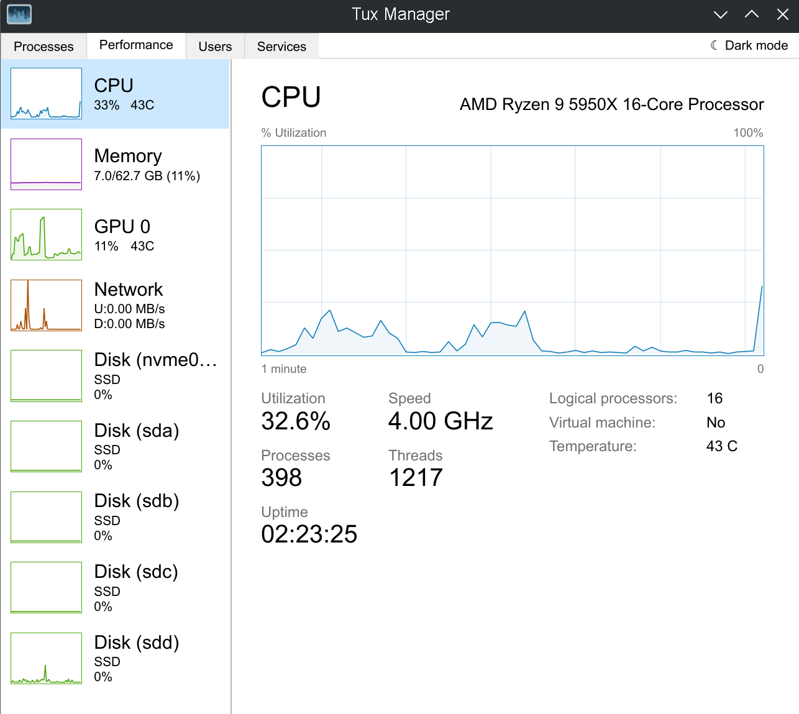
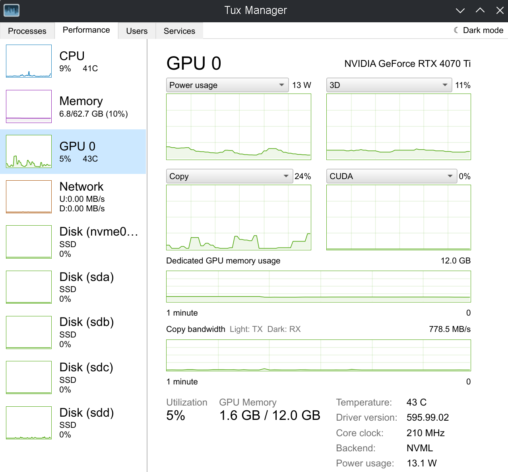
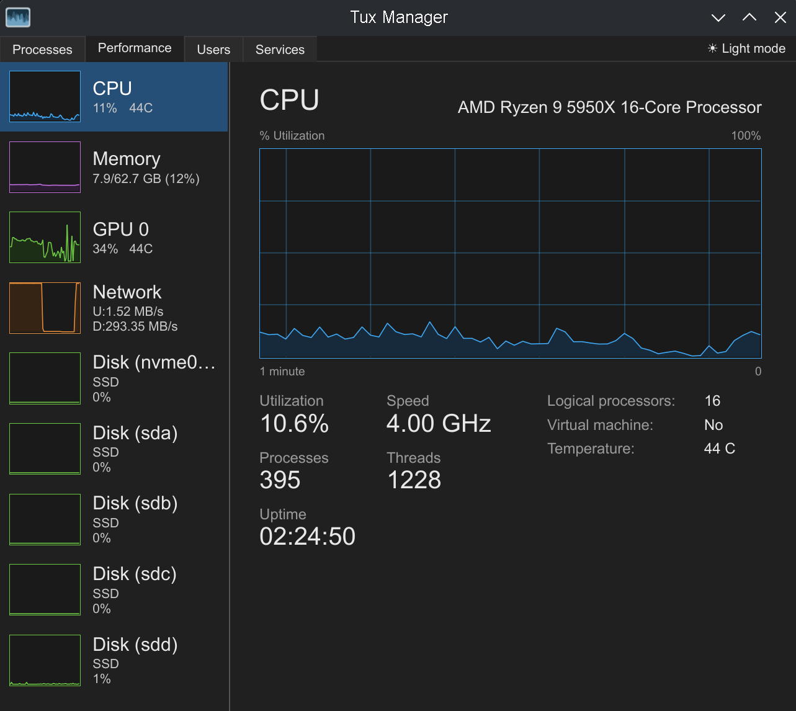
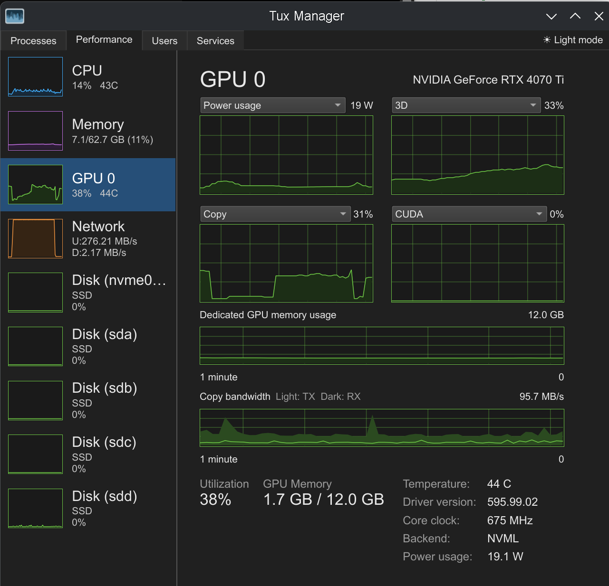

# Tux Manager

A Linux Task Manager alternative built with Qt6, inspired by the Windows Task Manager but designed to go further - providing deep visibility into system processes, performance metrics, users, and services.

> **TuxManager-Classic** — this is a fork of [benapetr/TuxManager](https://github.com/benapetr/TuxManager)
> with a flat, classic Task Manager look. All credit for the original program goes to Petr Bena;
> this fork only changes the appearance and a few defaults. Licensed under GPL-3.0 like the original.

| CPU (light) | GPU (light) |
| --- | --- |
|  |  |
| **CPU (dark)** | **GPU (dark)** |
|  |  |

## What this fork changes

**Look and feel**
- Flat classic theme independent of the desktop theme, with a light/dark toggle (tab-bar corner button or `Ctrl+Shift+D`)
- Arial font and a compact 0.8 UI scale by default (override with `TUX_MANAGER_SCALE=0.75`, `1.0`, …)

**Performance tab**
- Sidebar with thumbnail graphs and large titles; CPU/GPU temperature in a fixed column
- Detail pages with a large title and device name, graphs that keep their proportions, and big headline numbers with a compact details table
- GPU: *Power usage* added to the engine graphs (NVIDIA/NVML, scaled to the board power limit); default graphs are Power usage, 3D, Copy and CUDA; duplicate shared/dedicated memory stats removed
- Network: speeds always shown in MB/s, adapter shown as "Network", IPv6 row removed

**Processes tab**
- Two-line header with total CPU / Memory / Disk usage above the column names
- Heat-map shading of busy CPU, memory and disk cells
- Default columns Name, Status, CPU, Memory and a combined Disk (MB/s) column
- Grouped view: helper processes fold under their program, kernel threads fold under `kthreadd`

### Building this fork
```bash
sudo apt install build-essential qt6-base-dev qmake6
git clone https://github.com/Tosskek/TuxManager-Classic.git
mkdir build && cd build
qmake6 ../TuxManager-Classic/src/TuxManager.pro && make -j$(nproc)
./tux-manager
```

---

[Open full-size screenshots](screenshots/screenshots.md)

## Screenshots (Dark Theme)

| CPU | Memory | GPU |
| --- | --- | --- |
|  |  |  |

## Screenshots (Light Theme)

| CPU | Memory |
| --- | --- |
|  |  |
| Disk | Swap |
|  |  |
| Processes | Process tree |
|  |  |
| Users | Services |
|  |  |

## Installing

### Debian / Ubuntu / Fedora / EL derivatives (Rocky/Alma/OL)
Use prebuilt packages that can be downloaded from [releases](https://github.com/benapetr/TuxManager/releases)

### Arch Linux
Install from the official repositories:
```bash
sudo pacman -S tuxmanager
```

### Nixpkgs
The package is available as `tux-manager` in the unstable channels and will be available in the `nixos-26.11` stable channel and later.

### Nix flake
Add the following to your `flake.nix`:
```nix
inputs.tuxManager.url = "github:benapetr/TuxManager/";
inputs.tuxManager.inputs.nixpkgs.follows = "nixpkgs"; # optional, deduplicates dependencies
```
You can then access the package at: `inputs.tuxManager.packages.${pkgs.stdenv.hostPlatform.system}.default`

### Others
You can use an AppImage that can be downloaded from [releases](https://github.com/benapetr/TuxManager/releases) or just [build it](#building) yourself.

## Building

### qmake

```bash
# cd to root of the repo and then:
mkdir build && cd build
qmake6 ../src
make -j$(nproc)
./tux-manager
```

## Translating

To test a different UI locale without changing the system settings, override
the process locale when launching the application:

```bash
LC_ALL=zh_CN.UTF-8 ./tux-manager  # Simplified Chinese
LC_ALL=cs_CZ.UTF-8 ./tux-manager  # Czech
LC_ALL=pt_BR.UTF-8 ./tux-manager  # Brazilian Portuguese
LC_ALL=C ./tux-manager            # Built-in English
```

The requested locale may need to be generated or installed on the host system.

**Important note regarding AI-assisted translations:** Please do NOT submit translations generated "blindly" by AI without review by a native speaker of the language.

## Core philosophy and goals of this project

* KISS - keep it simple stupid
* Lean and clean codebase, minimal system footprint (low RAM and CPU usage)
* Stability and reliability, easy debugging
* No overengineered or unnecessary extra features
* Simple packaging flow - for each packaging tool, there should be a script or 1 line command
* Minimal dependencies on 3rd party libs besides Qt so that building anywhere should be trivial
* Keep everything well documented

## License

GPL-3.0-or-later
